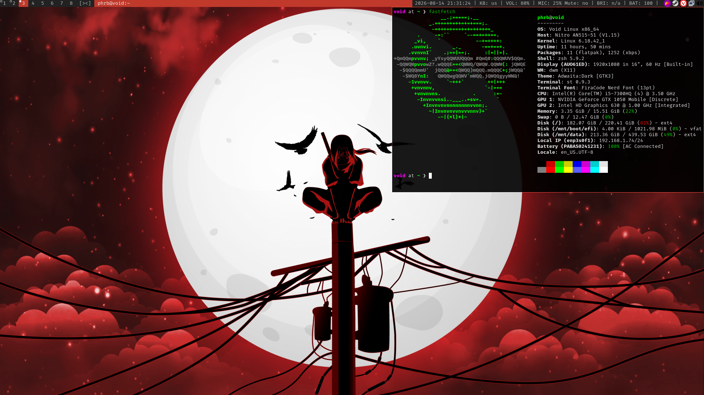
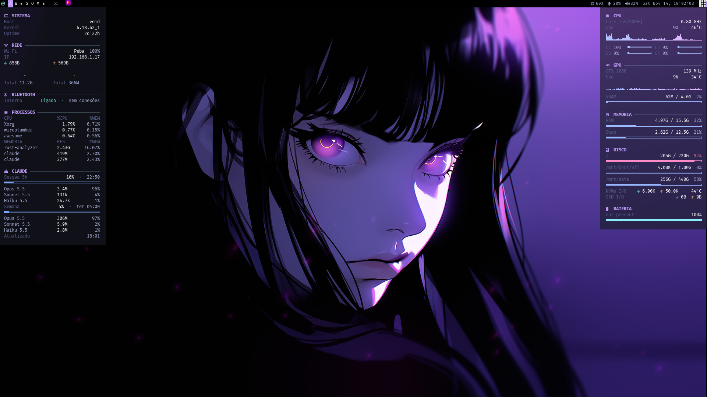

## dwm



## awesomewm



## Nova instalação

`setup/hardware.sh` detecta o hardware (GPU Intel/NVIDIA/AMD, notebook ou
desktop) e instala drivers, confs do Xorg e os programas que o awesome e o
conky usam. O resto (GPU no conky, discos, rede, bateria, brilho) se adapta
sozinho a cada sessão. Ver [setup/README.md](setup/README.md).

```sh
~/dotfiles/setup/hardware.sh -n   # o que seria feito
~/dotfiles/setup/hardware.sh
```

O VSCode oficial vai para `/opt/vscode` com `setup/vscode.sh` (instala e
atualiza). Ver [setup/README.md](setup/README.md#vscode).

## SSH agent

O `.zshrc` sobe um único `ssh-agent` num socket fixo
(`~/.ssh/agent/agent.sock`) e todo terminal novo reaproveita esse mesmo agent,
então não precisa mais de `eval "$(ssh-agent -s)"`. O `~/.ssh/config` (fora do
repo, por máquina) precisa ter:

```
Host *
  IdentityFile ~/.ssh/private/id_ed25519
  AddKeysToAgent yes
```

Assim a chave entra no agent sozinha no primeiro `ssh`/`git push`. A
passphrase é pedida uma vez por boot, porque o agent guarda as chaves só em
memória.

## Packages

VoidLinux base system

- Awesome WM
- DWM
- i3
- Vivaldi
- VSCode (oficial, em /opt/vscode via setup/vscode.sh)
- bat (a better cat)
- eza (a better ls)
- FiraCode Nerd Font
- MartianMono Nerd Font
- fzf-git
- kitty (on awesomewm)
- st (on dwm)
- lazygit
- lazydocker
- neovim (smoothvim)
- ripgrep
- pavucontrol
- brightnessctl (notebook) / ddcutil (desktop, brilho do monitor por DDC/CI)
- pamixer
- jq (seção Bluetooth do conky)
- xclip
- xorg-xclipboard
- xorg-xbacklight
- yazi
- conky (painel de sistema no awesome, ver conky/README.md)
- zsh
