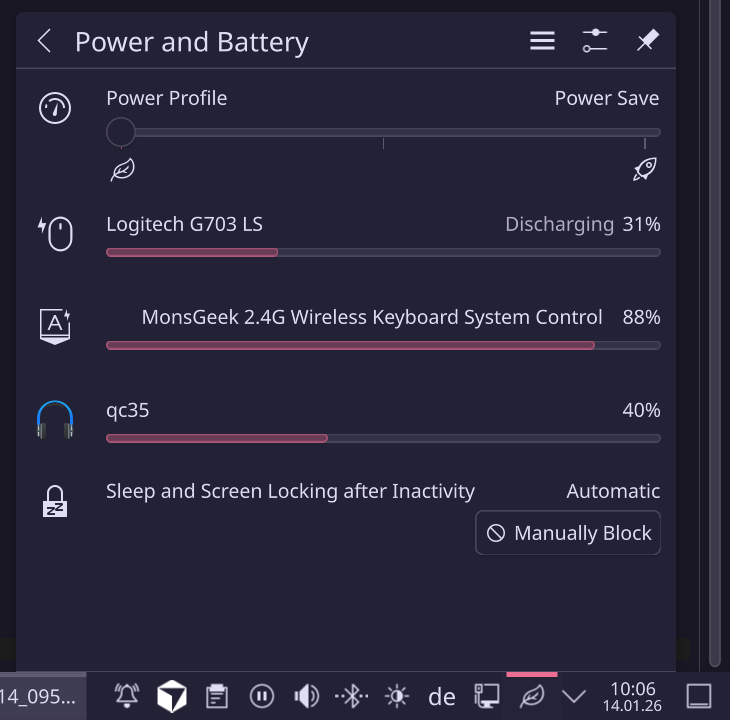

# MonsGeek/Akko Linux Driver
[tui-demo.webm](https://github.com/user-attachments/assets/3eeb464e-2593-4b6a-abe0-6e11d946288a)

[](https://github.com/echtzeit-solutions/monsgeek-akko-linux/actions/workflows/ci.yml)

A Linux userspace driver for MonsGeek, Akko, and other magnetic keyboards using RongYuan firmware (RY5088/YC3121 chipsets). Provides full configuration support via CLI, TUI, and gRPC server compatible with the official web configurator.

## Supported Devices

- MonsGeek M1 V5 HE (Wired) - VID:3151 PID:5030
- MonsGeek M1 V5 HE (Wireless/2.4GHz) - VID:3151 PID:503A
- Akko MOD007B-HE and other Akko HE keyboards (same protocol)

## Features

- **Full keyboard configuration** - LED modes, brightness, speed, colors
- **Per-key settings** - Actuation points, Rapid Trigger, DKS, Snap-Tap
- **Real-time key depth monitoring** - Visualize analog key travel
- **Audio reactive lighting** - Built-in frequency analyzer
- **Screen color sync** - Ambient lighting from screen content
- **GIF animations** - Upload or stream animations to keyboard
- **Key remapping and macros** - Remap keys, record text macros
- **gRPC server** - Compatible with official MonsGeek web app

## Installation

### Prerequisites

**Rust Toolchain** (if not already installed):
```bash
curl --proto '=https' --tlsv1.2 -sSf https://sh.rustup.rs | sh
```

### Host Dependencies

A default build (`make install-user` or `make driver`) links these native libraries:

| Library | Used for |
|---|---|
| libudev | device discovery and hot-plug |
| libpulse | audio-reactive mode (also works on PipeWire, through its pulse server) |
| PipeWire + libclang | screen color sync (libclang generates the PipeWire bindings) |
| OpenSSL | firmware update checks over HTTPS |

plus a C toolchain, `pkg-config` and `protoc` (the gRPC API is generated from
`proto/driver.proto`). The HID library itself (hidapi) is compiled in, so no hidapi
package is needed.

<details>
<summary><b>Debian / Ubuntu</b></summary>

```bash
sudo apt install build-essential pkg-config protobuf-compiler libudev-dev \
  libssl-dev libpulse-dev libpipewire-0.3-dev libclang-dev
```
</details>

<details>
<summary><b>Arch Linux / Manjaro / EndeavourOS</b></summary>

```bash
sudo pacman -S --needed base-devel protobuf libpulse pipewire clang
```
</details>

<details>
<summary><b>Fedora / RHEL / CentOS</b></summary>

```bash
sudo dnf install gcc make pkgconf-pkg-config protobuf-compiler systemd-devel \
  openssl-devel pulseaudio-libs-devel pipewire-devel clang-devel
```
</details>

<details>
<summary><b>openSUSE</b></summary>

```bash
sudo zypper install gcc make pkg-config protobuf-devel systemd-devel \
  libopenssl-devel libpulse-devel pipewire-devel clang-devel
```
</details>

<details>
<summary><b>Void Linux</b></summary>

```bash
sudo xbps-install -S base-devel pkg-config protobuf eudev-libudev-devel \
  openssl-devel pulseaudio-devel pipewire-devel clang
```
</details>

<details>
<summary><b>Alpine Linux</b></summary>

`pulseaudio-dev` and `pipewire-dev` are in the `community` repository; enable it in
`/etc/apk/repositories` first. libclang ships in a versioned package (`clang21-dev`
on current releases; any recent `clangNN-dev` works).

```bash
sudo apk add build-base pkgconf protoc eudev-dev openssl-dev \
  pulseaudio-dev pipewire-dev clang21-dev
```
</details>

**Without PipeWire/libclang:** screen color sync is a default feature. To build
without it (and drop the PipeWire and libclang requirements), build with
`cargo build --release --no-default-features --features firmware-api,notify`
in `iot_driver_linux/`, then install with `scripts/install-user.sh --no-build`.

### Per-user install (simplest)

```bash
git clone https://github.com/echtzeit-solutions/monsgeek-akko-linux.git
cd monsgeek-akko-linux

make install-user   # run as your user, not with sudo
```

This builds the driver and sets everything up under your home directory:

| What | Where |
|---|---|
| `iot_driver` binary (copied, so `cargo clean` does not break it) | `~/.local/bin/iot_driver` |
| `monsgeek` launcher: no arguments opens the TUI, otherwise runs a CLI command (`monsgeek info`) | `~/.local/bin/monsgeek` |
| Device database | `~/.local/share/akko/` |
| App menu entry that opens the TUI in a terminal | `~/.local/share/applications/` |
| Server autostart, so web.monsgeek.com works (see below) | depends on the init system |

It also starts the server right away, and asks for sudo only for system files: the
udev rules (when missing or outdated) and, on runit/OpenRC, the service definition.

**Server autostart.** The installer detects the init system and uses its native
service manager, falling back to XDG autostart:

| Init system | What is installed | Starts | sudo | Logs |
|---|---|---|---|---|
| systemd | user service `~/.config/systemd/user/monsgeek-iot-driver.service` | at login | no | `journalctl --user -u monsgeek-iot-driver` |
| runit (Void, Artix) | service running as you, `/etc/sv/monsgeek-iot-driver` (Artix: `/etc/runit/sv/...`) | at boot | once | `~/.local/state/akko/current` |
| OpenRC (Gentoo, Alpine, Artix) | supervised service running as you, `/etc/init.d/monsgeek-iot-driver` | at boot | once | `~/.local/state/akko/iot_driver.log` |
| anything else | XDG autostart entry `~/.config/autostart/monsgeek-iot-driver.desktop` | at login | no | `~/.local/state/akko/iot_driver.log` (first start only) |

The service managers restart the server if it crashes. XDG autostart entries are run by
desktop environments (KDE, GNOME, XFCE, Cinnamon, ...) but **not by bare window
managers** (awesome, i3, sway, Hyprland, bspwm, ...); on those, without one of the
init systems above, add `~/.local/bin/iot_driver serve` to the WM's startup. Force a
mode with `--autostart=systemd|runit|openrc|xdg|none`.

Rerun `make install-user` after pulling to update; `make uninstall-user` removes
everything except the udev rules. All options: `scripts/install-user.sh --help`
(`--autostart=`, `--no-build`, `--no-start`, `--no-udev`).

Make sure `~/.local/bin` is on your `PATH` (the installer warns if it is not).

### System-wide install

```bash
# Build and install driver + udev rules + device database
make driver
sudo make install
```

`make install` also installs the device database (key matrices, names, LED maps) and
offers to refresh it from the vendor driver first (default Yes) so newly-released models
are picked up; it falls back to the committed database if you decline, are offline, or
lack the extractor tools. To install the committed database without prompting:
`sudo make install SKIP_REFRESH=1`.

Then unplug and replug your keyboard.

Run `make help` to see all available targets:

```
Build targets (run as regular user):
  driver       Build driver release binary (default)
  driver-debug Build driver debug binary
  bpf          Build BPF loader
  bpf-ebpf     Build BPF eBPF program (requires nightly)
  test         Run tests
  check        Run clippy lints
  fmt          Format code
  clean        Clean all build artifacts

Install targets (run with sudo, after building):
  install         Install driver + udev rules
  install-all     Install everything (driver + BPF + systemd)
  install-driver  Install driver binary only
  install-udev    Install udev rules only
  install-bpf     Install BPF loader
  install-systemd Install systemd service for BPF auto-load
  uninstall       Remove all installed files
```

**Optional Cargo features:**

| Feature | Description | Extra Dependencies |
|---------|-------------|-------------------|
| `firmware-api` | Download firmware from cloud (default) | None |
| `screen-capture` | Screen color sync via PipeWire | `pipewire`, `clang` |

To build with optional features:
```bash
cd iot_driver_linux
cargo build --release --features "firmware-api,screen-capture"
```

### HID-BPF Battery Support (Kernel 6.12+)

The `akko-loader` BPF program exposes wireless keyboard battery level to the Linux power subsystem. **Requires kernel 6.12 or newer** due to HID-BPF struct_ops verifier requirements.



**Prerequisites:**

```bash
# Check kernel version (must be 6.12+)
uname -r

# Install nightly Rust and bpf-linker (one-time setup)
rustup install nightly
cargo install bpf-linker
```

**Build and install:**

```bash
# Build driver and BPF loader first (as regular user)
make driver
make bpf

# Install driver, BPF loader, and systemd service (as root)
sudo make install-all

# Or install BPF components separately:
sudo make install-bpf      # Install akko-loader + BPF program
sudo make install-systemd  # Install systemd service for auto-load
```

**Manual usage:**

```bash
# Check status
akko-loader

# Load BPF (requires root)
sudo akko-loader load

# Check battery
cat /sys/class/power_supply/hid-*/capacity

# Unload BPF
sudo akko-loader unload
```

The BPF program pins to `/sys/fs/bpf/akko` and persists until unloaded.

**Known limitations:**

- **Charging status not available**: The stock HID protocol does not expose charging status. The power supply will always show "Discharging". Only battery percentage is available. For charging status support, see the [firmware patch](docs/FIRMWARE_PATCH.md) which adds native HID battery with charge detection.

**Automatic loading with udev/systemd:**

For automatic battery support when the keyboard connects, install the systemd service (included in `make install-all` or separately via `make install-systemd`).

How it works:
- When the keyboard connects, udev detects the device (VID:3151 PID:5038)
- udev triggers `akko-bpf-battery.service` via `SYSTEMD_WANTS`
- The service runs `akko-loader load` to attach the BPF program
- Battery level appears in `/sys/class/power_supply/` and desktop battery monitors
- When the keyboard disconnects, udev stops the service which runs `akko-loader unload`

Check service status:
```bash
systemctl status akko-bpf-battery.service
```

**Without systemd** (runit, OpenRC, ...): the udev rule's `SYSTEMD_WANTS` hook does
nothing there, so there is no automatic load. Run `sudo akko-loader load` once the
dongle is connected, and again after reconnecting it (the systemd setup does exactly
this on every plug-in).

## Usage

### CLI Overview

For the complete command reference, see [docs/CLI.md](docs/CLI.md).

**Global debugging flags** (work with any command):
- `--monitor` - Trace all HID commands/responses
- `--file <pcap>` - Replay pcap capture file
- `--hex` - Show raw hex dumps
- `--filter <f>` - Filter packets (`all`, `events`, `commands`, `cmd=0xNN`)

**Common commands:**
```bash
iot_driver info              # Device ID and firmware
iot_driver led               # LED settings
iot_driver set-led wave 4 3  # Set LED mode
iot_driver triggers          # Show trigger settings
iot_driver set-rt on 0.3     # Enable Rapid Trigger
iot_driver tui               # Interactive TUI
iot_driver serve             # Start gRPC server
```

See [docs/CLI.md](docs/CLI.md) for all 60+ commands including remapping, macros, animations, audio reactive, and firmware tools.

### Interactive TUI

Launch the terminal user interface for interactive control:

```bash
iot_driver tui
```

<video src="iot_driver_linux/tui-demo.webm" controls width="100%"></video>

**TUI Features:**
- Tab navigation between Device Info, LED Settings, Key Depth, Triggers, Options, Macros
- Real-time key depth visualization (bar chart and time series)
- Visual keyboard layout for per-key trigger settings
- Arrow keys to adjust values, Enter to confirm

**Key Depth Tab:**
- `v` - Toggle between bar chart and time series view
- `Space` - Select key for time series tracking
- `x` - Clear depth history

**Triggers Tab:**
- `v` - Toggle between list and keyboard layout view
- Arrow keys - Navigate keys in layout view
- `n/t/d/s` - Set mode (Normal/RT/DKS/SnapTap) for selected key
- `N/T/D/S` - Set mode for ALL keys

### Web App (app.monsgeek.com)

The driver includes a gRPC server that's compatible with the official MonsGeek web configurator.

**Start the server:**
```bash
iot_driver serve
```

The server runs on `127.0.0.1:3814` with gRPC-Web support.

**Connect from web app:**

1. Start the driver server: `iot_driver serve`
2. Open https://app.monsgeek.com in your browser
3. The web app will detect and connect to your keyboard
4. Use the full web UI for configuration

**Note:** The web app expects the server at localhost:3814. All keyboard features are accessible through the web interface including:
- LED mode selection and color picker
- Per-key RGB customization
- Trigger/actuation settings
- Key remapping
- Macro editor
- Firmware updates (use with caution)

## LED Modes

| # | Mode | Description |
|---|------|-------------|
| 0 | Off | LEDs disabled |
| 1 | Constant | Static color |
| 2 | Breathing | Pulsing effect |
| 3 | Neon | Neon glow |
| 4 | Wave | Color wave |
| 5 | Ripple | Ripple from keypress |
| 6 | Raindrop | Raindrops |
| 7 | Snake | Snake pattern |
| 8 | Reactive | React to keypress (stay lit) |
| 9 | Converge | Converging pattern |
| 10 | Sine Wave | Sine wave |
| 11 | Kaleidoscope | Kaleidoscope |
| 12 | Line Wave | Line wave |
| 13 | User Picture | Custom per-key (4 layers) |
| 14 | Laser | Laser effect |
| 15 | Circle Wave | Circular wave |
| 16 | Rainbow | Rainbow/dazzle |
| 17 | Rain Down | Rain downward |
| 18 | Meteor | Meteor shower |
| 19 | Reactive Off | React briefly |
| 20 | Music Patterns | Audio reactive patterns |
| 21 | Screen Sync | Ambient screen color |
| 22 | Music Bars | Audio reactive bars |
| 23 | Train | Train pattern |
| 24 | Fireworks | Fireworks |
| 25 | Per-Key Color | Dynamic animation (GIF) |

## Per-Key Modes

| Mode | Description |
|------|-------------|
| Normal | Standard actuation/release points |
| Rapid Trigger (RT) | Dynamic actuation based on movement |
| DKS | Dynamic Keystroke (4-stage trigger) |
| Mod-Tap | Different action for tap vs hold |
| Toggle Hold | Toggle on hold |
| Toggle Dots | Toggle on double-tap |
| Snap-Tap | SOCD resolution (bind to another key) |

## Troubleshooting

### Permission Denied
Make sure udev rules are installed and you've re-plugged the keyboard.

### Device Not Found
```bash
iot_driver list  # Check if device is visible
lsusb | grep 3151  # Verify USB connection
```

### TUI Not Starting
The TUI requires a proper terminal. It won't work in background mode or without a TTY.

### Web App Not Connecting
1. Ensure server is running: `iot_driver serve`
2. Check firewall isn't blocking port 3814
3. Verify with: `curl -v http://127.0.0.1:3814`

## Firmware Patches

See [docs/FIRMWARE_PATCH.md](docs/FIRMWARE_PATCH.md) for the custom firmware patches that add:

- **Battery over USB HID** — Native power_supply integration (no BPF needed), with charging status
- **LED streaming** — Per-key RGB control for GIF animations at ~30fps
- **Patch discovery** — 0xFB vendor command for capability detection

Patches are available for both the keyboard and the 2.4GHz wireless dongle. Stock firmware features are fully preserved. The doc also covers the [eBPF alternative](docs/FIRMWARE_PATCH.md#comparison-firmware-patch-vs-ebpf) for battery without flashing.

## Hardware Documentation

See [docs/HARDWARE.md](docs/HARDWARE.md) for detailed hardware documentation, including:

- MCU specifications (AT32F405, PAN1080, dongle)
- Flash memory map and bootloader behavior
- Debug interfaces (SWD pinouts for keyboard and dongle)
- Battery ADC quirks and measurements
- ROM DFU recovery procedure
- Flash Access Protection (FAP) safety notes

## Protocol Documentation

See [docs/PROTOCOL.md](docs/PROTOCOL.md) for the complete HID protocol specification, including:

- Transport layer details (USB wired, 2.4GHz dongle, Bluetooth LE)
- Message format and checksum algorithms
- Complete command reference (SET/GET commands)
- Data structures (LED params, trigger settings, key matrix)
- Event notifications and key depth monitoring
- Device database (VID/PID table)

## License

This project is licensed under the **GNU General Public License v3.0** - see the [LICENSE](LICENSE) file for details.

This means you're free to use, modify, and distribute this software, but any modifications must also be released under GPL-3.0.

## Acknowledgments

- Protocol reverse-engineered from the official MonsGeek Windows driver
- Inspired by the need for Linux support for HE keyboards
